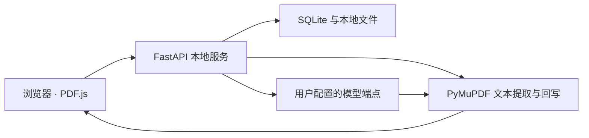

# 西浦课件通 · XJTLU CourseMate

面向课程学习的本地网站：把英文 PDF、中文对照译制版、课件解读和课程总结放在同一个工作空间。

这是个人学习项目，与西交利物浦大学没有官方隶属关系。仓库中的两份讲义均为项目自行生成的模拟材料，不包含真实学生课件、学习记录或 API Key。

## 界面预览

以下图片是运行本项目后截取的真实界面，使用内置模拟模型和自生成示例。中文译文与分析来自预设演示内容，用于展示完整流程，**不代表真实模型的翻译质量或回答能力**。

### 左侧英文原版，右侧中文对照


### 单份课件解读


### 课程总结与 PDF 预览


## 可以做什么

- **双栏 PDF 阅读：** 保留上传的原始英文 PDF；生成单独的中文译制版，支持同步滚动和文件下载。
- **文本块翻译：** 提取文本及其位置，将译文回写到原页面，尽量维持页面大小、图形和配色。中文长度变化会导致字号与布局调整，无法保证所有复杂版式完全一致。
- **AI 助教：** 使用用户自己的 API Key 接入 OpenAI 兼容接口；基于选定课件或课程摘录进行流式问答并保留历史。
- **课件辅导分析：** 翻译完成后，用内置 IMIS 课程辅导提示词生成课程定位、结构总览、核心概念、复习提示、工作应用和自测题。
- **课程总结：** 将已完成的课件整理成 Markdown 与 PDF；新增课件后显示待纳入数量，支持增量更新和更新历史。
- **重复内容缓存：** 相同模型名与原文文本块复用已有译文；任务中断后可重新尝试。

## 本地运行

需要 Python 和项目依赖。此次验证使用 Python 3.13.14、PyMuPDF 1.28.2；前端内置 PDF.js 3.11.174，无需构建前端。

### Windows

双击 `start.bat`。首次运行会建立 `.venv` 并安装 `requirements.txt` 中的依赖，然后启动本地服务。

打开 <http://127.0.0.1:8000>。关闭服务窗口后网站停止运行；数据库与已有文件仍保留在本机。

### 手动启动

```bash
python -m venv .venv
# Windows
.venv\Scripts\activate
# macOS / Linux
# source .venv/bin/activate
python -m pip install -r requirements.txt
python -m uvicorn app.main:app --host 127.0.0.1 --port 8000
```

### 不调用真实模型的演示

Windows 可双击 `demo.bat`。也可在已安装依赖的环境中分别运行两个终端：

```bash
# 终端一：模拟 OpenAI 兼容模型，端口 9999
python tests/mock_llm.py

# 终端二：网站服务
python -m uvicorn app.main:app --host 127.0.0.1 --port 8000
```

在网站内依次操作：

1. 打开「设置」，选择「离线演示（模拟回复）」，点击「保存配置」。演示 Key 为 `demo`。
2. 新建课程，点击「载入内置示例课件」。
3. 等待翻译完成，选择课件查看双栏 PDF；展开下方「AI 辅导分析」。
4. 进入「课程总结」，点击「更新总结」，查看并下载生成的 PDF。
5. 进入「AI 助教」提问，体验流式回复和对话历史。

模拟服务仅为内置示例提供固定译文、固定总结和固定分析，不具备通用翻译、推理或课程问答能力。未收录的文本会标记为演示并保留原文。

## 接入自己的模型

在「设置」页填入 API Base URL、API Key 和模型名称，先测试连接，再保存配置。已提供若干服务商和本地 Ollama 的配置示例，也可以填写其他 OpenAI Chat Completions 兼容接口。

**预设中的模型名称仅是示例。模型可用性、价格、赠送额度、免费政策和限流规则均以服务商当前政策及你的账户实际情况为准。** 项目不承诺某一模型永久免费，也不提供固定翻译成本估算。

使用远程模型时，后端会向配置的服务端点发送 API Key、待翻译文本、问题和相关课件摘录；请根据材料使用权限选择模型。使用本地 Ollama 时，需要自行安装模型并确认相应许可和硬件要求。

## 数据与部署范围

这是**无账户认证的单用户本地版本**，默认只监听 `127.0.0.1`。

- API Key、各服务商保存的 Key、课程信息和对话记录存于本机 `data/app.db`，其中 Key 是明文存储，数据库没有应用级加密。
- 上传的 PDF、译制版和分析存于 `data/files/`，课程总结 PDF 存于 `data/summaries/`。
- 设置接口会将保存的服务商 Key 返回给本地页面，以便切换预设时自动填写；隐藏输入框和 Key 提示不等于加密。
- 前端 PDF.js 主脚本与 worker 已放入 `static/vendor/`，正常阅读不需要 CDN；网页保留了主脚本缺失时的 CDN 回退。
- `.gitignore` 排除了 `data/`、虚拟环境、数据库、日志和 `.env`。仓库内保留的 PDF 仅为自行生成的模拟讲义。

如需部署为多人使用或暴露到网络，需先补充身份认证、数据隔离、访问控制和密钥管理。自定义演示或测试数据目录可设置环境变量 `COURSEMATE_DATA_DIR`，不设置时仍使用项目内的 `data/`。

## 目录与架构

```text
app/
  main.py                HTTP 接口与静态网页托管
  database.py            SQLite 数据访问与轻量迁移
  llm.py                 OpenAI 兼容客户端、翻译与流式回复
  translate_service.py   后台翻译、缓存和中断恢复
  pdf_utils.py           文本块提取、中文回写和总结 PDF 排版
  course_tutor.py        单份课件解读任务
  skill/                 IMIS 辅导提示词与课程知识参考
static/
  index.html             原生网页界面
  css/  js/              蓝紫白样式与交互
  vendor/                PDF.js 主脚本、worker 与许可证
sample_data/             两份自行生成的英文模拟讲义
tests/                  演示模型、示例生成器、端到端回归
docs/images/            实际运行截图
```



## 验证

原项目的 `tests/` 包含模拟模型和示例生成器。公开副本补充了实际 HTTP 流程回归，运行时自动使用临时数据库、本机模拟模型和临时端口，不读取原项目的数据库或 Key。

```bash
python -m unittest discover -s tests -p "test_*.py" -v
```

覆盖：无效 PDF 拒绝、模型连接、两份示例上传和自动翻译、页数和页面大小保持、中文文本写入、原始背景保持、课件解读、总结 PDF、追加课件后的增量更新、流式问答历史与课程级联删除。真实供应商接口效果、费用和限流不属于本次模拟验证范围。

可重新生成仓库内示例：

```bash
python tests/make_sample_pdf.py
```

## 已知限制

- 扫描件或纯图片 PDF 没有文本层，当前不支持 OCR 翻译。
- 复杂表格、公式、艺术字、竖排文本和拥挤版式可能需要人工调整；个别模型请求失败时可能保留原文。
- AI 问答只读取有限长度的课件摘录；整门课程上下文默认取最近三份已完成课件，并非全文检索系统。
- AI 解读、总结和复习提示应与原课件核对，不保证正确，也不能替代授课教师确定的考核范围。
- 当前总结 PDF 使用轻量 Markdown 排版，历史条目保留文本，但 PDF 下载指向当前生成文件。

## 第三方组件

PDF.js 3.11.174 的原始著作权头部已保留，完整 Apache 2.0 许可见 [`static/vendor/LICENSE.txt`](static/vendor/LICENSE.txt)，项目来源为 [Mozilla PDF.js](https://github.com/mozilla/pdf.js/tree/v3.11.174)。其他 Python 依赖通过 `requirements.txt` 安装，遵循各自许可证。本仓库没有为第三方组件重新授权。
