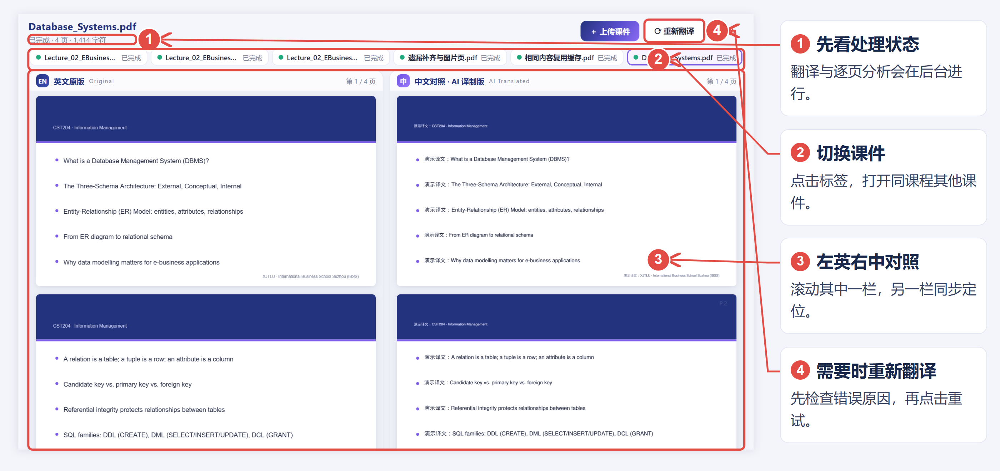
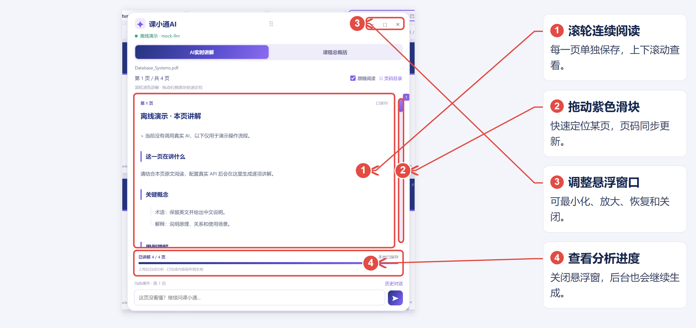
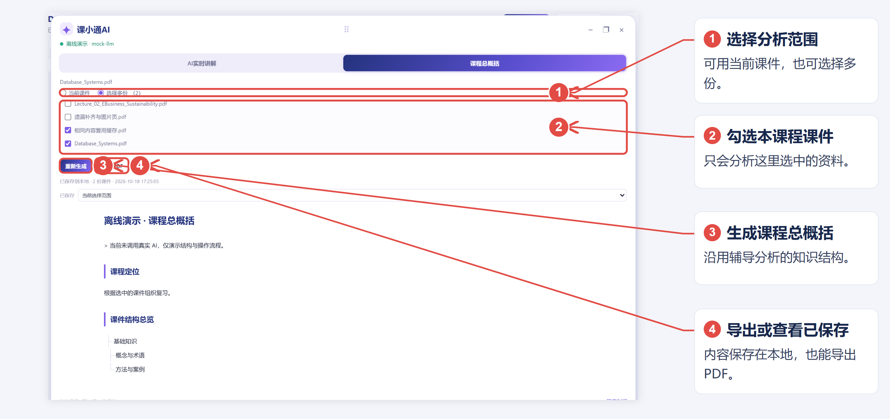
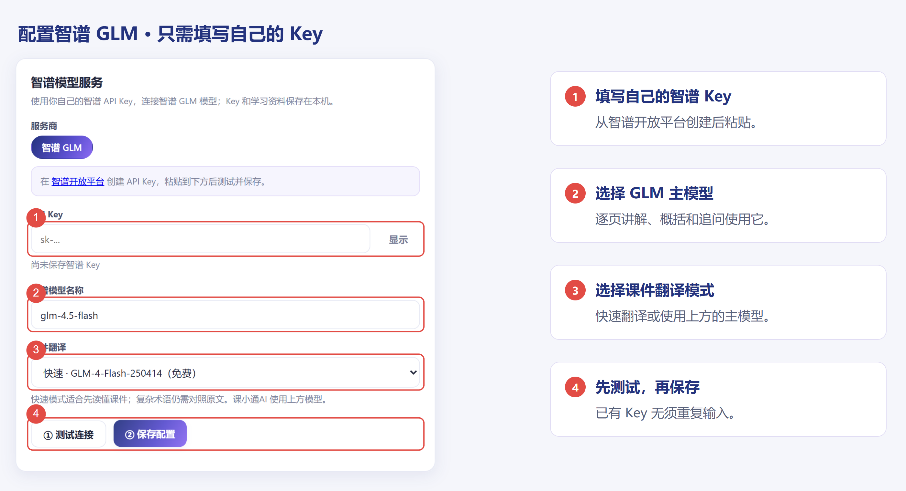

# 课小通

本地课程资料学习工具：上传英文 PDF，查看中文对照，并用悬浮的「课小通AI」逐页理解课件、继续提问或整理多份资料。

**当前版本：v1.2.0（2026-10-19 更新）**。界面名称已调整为「课小通」，设置页仅提供智谱 GLM 服务。

这是个人学习项目，与西交利物浦大学没有官方隶属关系。公开源码和软件分享包均不包含个人课件、学习记录或 API Key。

## Windows 直接使用

**[下载最新版软件](https://github.com/shiliuye605/xjtlu-coursemate/releases/latest)**

1. 在 Releases 下载 `西浦课件通-Windows64位-v1.2.0.zip`，完整解压。
2. 双击紫色图标的 `西浦课件通.exe`，无须安装 Python。请保留旁边的 `_internal` 文件夹。
3. 进入「设置」，填写自己的智谱 API Key，测试连接后保存。
4. 新建课程并上传可选中文字的 PDF。右上角「使用说明」或 F1 可打开带实际页面标注的教程。

界面名称为「课小通」；现有软件文件名、桌面窗口标题及数据目录沿用旧名称，以便直接升级和继续使用已有资料。适用于 Windows 10 1809 或更新版本、Windows 11 的 64 位电脑。

## 现在的功能

- **双栏 PDF 阅读**：左侧英文原版，右侧中文译制版，同步滚动；译文按原页面位置回写，保留图片和图形。
- **自动逐页讲解**：提取文字后即进入后台分析，不必打开助手或等待全文翻译完成。每页单独保存，显示完成、等待或错误状态。
- **悬浮课小通AI**：拖动、调整大小、最小化、放大、恢复、关闭；用滚轮连续阅读，或拖动紫色竖向滑块、使用页码目录定位。
- **当前页追问**：基于当前页和讲解进行流式问答，历史保存在本机。
- **课程总概括**：选择当前课件或同一课程的多份课件，生成课程定位、结构、概念、术语、重点、应用与自测，可导出 PDF。
- **本地缓存与恢复**：已完成的讲解即时保存；退出软件后暂停，重开继续未完成部分。旧分析、旧课程总结和对话记录继续保留。
- **智谱专用设置**：固定官方接口，配置自己的 Key 和 GLM 模型；快速翻译使用 `glm-4-flash-250414`，课小通AI使用设置中的主模型。

模型可用性、计费、额度和限流以智谱平台及账户实际情况为准。软件不提供共享 Key。

## 实际界面

以下截图来自运行中的界面，使用自行生成的示例讲义和明确标注的模拟内容；用于说明交互流程，**不代表真实 AI 的翻译或回答质量**。

### 英文与中文对照阅读



### 悬浮逐页讲解



### 多课件课程总概括



### 智谱服务配置



## 源码运行

验证环境：Python 3.13.14、PyMuPDF 1.28.2。前端使用原生 HTML/CSS/JavaScript 和本地 PDF.js，无须前端构建。

```bash
python -m venv .venv
# Windows
.venv\Scripts\activate
# macOS / Linux: source .venv/bin/activate
python -m pip install -r requirements.txt
python -m uvicorn app.main:app --host 127.0.0.1 --port 8000
```

打开 <http://127.0.0.1:8000>，在设置页配置智谱。Windows 也可使用 `start.bat`。

桌面启动入口是 `desktop_launcher.py`。桌面构建脚本为 `build_app.py`，还需安装相应 PySide6、Qt WebEngine 与 PyInstaller；本次打包组件版本和第三方许可随 Releases 软件包提供。网页源码运行不需要 Qt。

## 数据与模型请求

- 桌面版数据保存在 `%LOCALAPPDATA%\XJTLUCourseMate\data`，升级或重新解压不会自动清空。软件「文件」菜单可打开该目录。
- 网页源码运行默认使用项目内 `data/`，也可通过 `COURSEMATE_DATA_DIR` 指定其他数据目录。
- 数据库保存课程、设置、缓存和对话；PDF、分析和概括文件保存在本地。Key 使用本机 SQLite 明文存储，界面中的隐藏与掩码并非加密。
- 真实 AI 功能会向智谱发送 Key、待处理文本及有关的课件摘录。查看已保存结果不需要重新生成。
- 这是默认仅监听 `127.0.0.1`、没有用户认证的单用户工具；不应直接当作多人网站开放到公网。
- 分享 Releases 的干净软件包即可，不要分享自己的数据目录。

## 目录

```text
app/                    本地 HTTP 服务、翻译、逐页讲解、概括与数据库
app/skill/              IMIS 课程辅导结构与参考材料
static/                 页面、悬浮窗、图文说明及本地 PDF.js
desktop_launcher.py     Windows 桌面窗口和本地服务入口
build_app.py            Windows 软件包构建
desktop/                图标与组件许可
sample_data/            两份自行生成的英文示例讲义
tests/                  本地模拟模型与自动检查
docs/images/            示例界面的实际截图
```

## 验证与限制

本次版本通过翻译与逐页分析的 52 项单元检查和 1 项完整 HTTP 流程检查，以及独立的后台流程、浏览器交互和 Windows 软件包检查；曾使用配置的智谱接口完成两页合成 PDF 的真实翻译、讲解与概括验证。耗时取决于文档和服务响应。

```bash
python -m unittest discover -s tests -p "test_*.py" -v
```

测试使用临时目录和本地模拟模型；模拟模型保留为开发辅助，不作为设置页中的服务选项。

- **没有 OCR**：纯图片或扫描页无法提取文字时会明确提示；当前文字模型不会猜测图片中的内容。
- 中文长度、复杂表格、公式、艺术字和混合方向可能造成版式偏差，需要对照原文。
- AI 讲解、补充例子和推测的考点可能有误，不代替老师要求或原始资料。
- 翻译和分析仍可能受网络、排队和账户限流影响；失败可重试，已保存内容可继续查看。

第三方依赖保留各自许可；软件包内附有应用源码、组件版本及相应许可说明。
